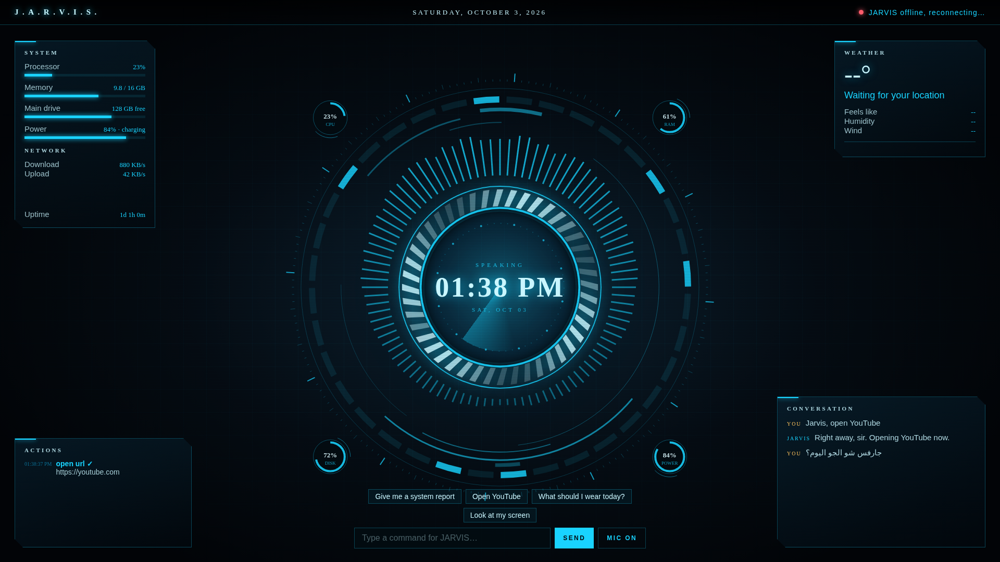

# 🤖 JARVIS: Your Own Iron Man–Style AI Assistant

A real-time voice assistant for Windows, inspired by JARVIS from Iron Man. Talk to it naturally in **English or Arabic**, interrupt it mid-sentence, and let it control your PC, all through a sci-fi HUD that reacts to its voice.

> Free to run with a Gemini API key. No subscription needed.



---

## ✨ Features

- **🎙️ Live voice conversation:** no wake word. Just talk; it answers in about a second, and you can interrupt it like a real conversation.
- **🌍 English + Arabic:** it understands both and replies in the language you speak.
- **🖥️ Controls your PC:** opens and closes apps, switches windows, types, presses shortcuts, runs PowerShell commands, and can look at your screen and click.
- **🎵 Media:** plays YouTube instantly, plus play/pause, next track, and volume.
- **📞 Phone calls:** dials through your own phone using Windows **Phone Link**.
- **💬 Messages:** sends WhatsApp messages and Gmail emails, after reading them back to you for a spoken "yes."
- **📇 Smart contacts:** tell it a number once and it remembers. It can also find business numbers with Google Search.
- **🛡️ Voice-confirmed safety:** risky actions (deleting files, shutdown, registry edits) need a spoken "yes" first.
- **🌀 Animated HUD:** a glowing reactor core that reacts to its voice and yours, live captions, an action log, CPU/RAM/disk/battery gauges, a network graph, and weather.
- **🗣️ British butler voice:** the Gemini voice or a free Microsoft British voice, with an optional "AI system" voice effect.
- **🚀 Desktop shortcut:** one double-click to launch.

---

## 📋 Requirements

- **Windows 10 or 11.** Some features also work on macOS/Linux, but this project is built and tested on Windows.
- **Python 3.12 or newer** from [python.org](https://www.python.org/downloads/). Tick **"Add Python to PATH"** during install.
- **A microphone and speakers.** Headphones are strongly recommended, so JARVIS doesn't hear himself.
- **A free Gemini API key** from [aistudio.google.com](https://aistudio.google.com).
- **Microsoft Edge** for the HUD window. It comes with Windows.

---

## 🚀 Installation

### 1. Download the project
Click **Code → Download ZIP** on this page and unzip it, or run:
```bash
git clone https://github.com/YOUR-USERNAME/jarvis.git
cd jarvis
```

### 2. Install the Python packages
Open PowerShell in the project folder and run:
```bash
pip install -r requirements.txt
```
If the download keeps failing with an SSL error, your connection is dropping. Try:
```bash
pip install -r requirements.txt --retries 10 --timeout 120
```

### 3. Get your free Gemini key
1. Go to [aistudio.google.com](https://aistudio.google.com).
2. Click **Get API key**, then **Create API key**, and copy it.

### 4. Create your `.env` file
1. Make a copy of `.env.example` and rename the copy to **`.env`**.
2. Open it in Notepad and paste your key:
   ```
   GEMINI_API_KEY=your_key_here
   ```
3. Save it.

Windows sometimes secretly names the file `.env.txt`. Check by running `dir -Force` in the folder; if needed, run `ren .env.txt .env`.

### 5. Run JARVIS
```bash
python jarvis_live.py
```
The HUD opens full-screen and JARVIS greets you. Start talking. 🎉

### 6. (Optional) Desktop shortcut
Double-click **`install_shortcut.bat`**. A **JARVIS** icon appears on your Desktop; double-click it anytime to launch.

---

## 🗣️ Things to say

| You say | JARVIS does |
|---|---|
| "Open Spotify" | Opens the app |
| "Play Lo-fi beats on YouTube" | Plays the top result |
| "Next song" / "Volume up" | Media control |
| "Close Chrome" | Closes the app |
| "How much free space is on my C drive?" | Runs a command and tells you |
| "Look at my screen. What's this error?" | Takes a screenshot and explains |
| "Ahmad's number is +1 555 123 4567" | Saves the contact |
| "Call Ahmad" | Dials through Phone Link |
| "WhatsApp Ahmad that I'm on my way" | Reads it back, then sends after you say yes |
| "شو الجو اليوم؟" ("What's the weather today?") | Answers in Arabic |

You can also **type commands** or tap the quick buttons at the bottom of the HUD.

---

## ⚙️ Optional setup

### 📞 Phone calls (Phone Link)
1. Open **Phone Link** from the Start menu and pair your phone. On Android, install "Link to Windows"; on iPhone, pair over Bluetooth.
2. Turn on **Calls** in Phone Link and allow the permissions it asks for on your phone.
3. Say *"Call [name]"*. JARVIS mutes his mic during the call; click **MIC** on the HUD after you hang up.

### 💬 WhatsApp
Install **WhatsApp Desktop** from the Microsoft Store and log in.

### 📧 Email
Turn on Gmail **2-Step Verification**, create an **App Password**, and add both to `.env`:
```
GMAIL_ADDRESS=you@gmail.com
GMAIL_APP_PASSWORD=xxxx xxxx xxxx xxxx
```

### 🌦️ Weather location
Edge asks for your location once. Or set it manually in `.env`:
```
HUD_LAT=40.71
HUD_LON=-74.00
HUD_TEMP_UNIT=fahrenheit
```

---

## 🎚️ Customizing the voice

All voice settings live in `.env`. Restart JARVIS after any change.

| Setting | What it does |
|---|---|
| `VOICE_ENGINE=gemini` | Gemini's own voice. The fastest option, with instant interruption. |
| `VOICE_ENGINE=ryan` | Free Microsoft British voice. A stronger accent, about 1 second slower. |
| `LIVE_VOICE=Charon` | The Gemini voice to use. Try `Iapetus`, `Sadaltager`, `Rasalgethi`, or `Orus`. |
| `EDGE_VOICE=en-GB-RyanNeural` | The British voice when `VOICE_ENGINE=ryan`. Also try `en-GB-ThomasNeural`. |
| `EDGE_PITCH=-4Hz` / `EDGE_RATE=-5%` | Deeper or slower British voice. |
| `VOICE_FX_AMOUNT=1.0` | "AI system" effect strength: `0.5` is subtler, `1.5` is stronger. |
| `VOICE_FX=0` | Turns the effect off. |
| `HALF_DUPLEX=1` | Mutes the mic while JARVIS talks. Use this if you have no headphones. |

To compare the British voices side by side, run:
```bash
python voice_test.py
```

---

## 🧠 Other AI brains (classic mode)

`jarvis_live.py` uses **Gemini Live** for real-time voice. There's also a **classic mode**, `jarvis.py`, that uses a wake word ("Jarvis") and works with other AI providers:

| `PROVIDER=` | Cost | Notes |
|---|---|---|
| `gemini` | Free tier | Default |
| `ollama` | Free and unlimited | Runs fully on your PC with [Ollama](https://ollama.com), e.g. `ollama pull qwen3:8b` |
| `grok` | Paid | Needs `XAI_API_KEY` |
| `claude` | Paid | Needs `ANTHROPIC_API_KEY` |

```bash
python jarvis.py --text   # type to test
python jarvis.py          # voice, with the "Jarvis" wake word (needs a free PICOVOICE_ACCESS_KEY)
```

---

## 📁 Project structure

```
jarvis/
├── jarvis_live.py          # Main app: real-time voice conversation
├── jarvis.py               # PC-control tools + classic wake-word mode
├── hud.py                  # Runs the HUD and streams live data to it
├── hud_web/index.html      # The animated HUD interface
├── edge_voice.py           # British Microsoft voice engine
├── voice_fx.py             # "AI system" voice effect
├── voice_test.py           # Compare British voices side by side
├── start_jarvis.bat        # Launcher
├── install_shortcut.bat    # Creates the desktop shortcut
├── jarvis.ico              # Shortcut icon
├── requirements.txt
├── .env.example            # Settings template (copy to .env)
└── contacts.example.json   # Example contacts format
```

---

## 🛠️ Troubleshooting

| Problem | Fix |
|---|---|
| `KeyError: 'GEMINI_API_KEY'` | Your `.env` is missing or named `.env.txt`. See step 4. |
| HUD shows **404 File not found** | `index.html` must be inside a `hud_web` folder (or next to `hud.py`). |
| HUD says **"JARVIS offline"** | Check the black JARVIS window for an error message. |
| Error `10048` / "only one usage of each socket address" | JARVIS is already running. Close the old window or end **Python** in Task Manager. |
| JARVIS keeps interrupting himself | Use headphones, or set `HALF_DUPLEX=1`. |
| No Live model connects | Check your key, or set `LIVE_MODEL=` to a Live model listed in AI Studio. Also try `WEB_LOOKUP=0`. |
| Error `429` | You hit Gemini's free rate limit. Wait a minute. |
| pygame fails to install | Make sure `requirements.txt` says `pygame-ce`, not `pygame`. |

---

## 🔒 Privacy & safety

- Your **`.env` file holds your API keys. Never upload or share it.** It's already excluded by `.gitignore`.
- `contacts.json` (your saved numbers) is also excluded from uploads.
- JARVIS can control your computer. Risky commands, emails, and messages always need your spoken "yes," but stay aware of what you ask it to do.
- Voice audio is sent to Google's Gemini API to be understood and answered. On Gemini's free tier, Google may use your prompts to improve its models.

---

## ⚠️ Disclaimer

This is an unofficial fan project for personal and educational use. It is **not affiliated with or endorsed by Marvel, Disney, or Paul Bettany**. "JARVIS" and Iron Man belong to their respective owners. The voices used are generic AI voices, not the actor's voice.

---

## 🙌 Credits

Built with [Gemini Live API](https://ai.google.dev), [edge-tts](https://github.com/rany2/edge-tts), [Open-Meteo](https://open-meteo.com) (weather), [PyAutoGUI](https://github.com/asweigart/pyautogui), [sounddevice](https://github.com/spatialaudio/python-sounddevice), and [psutil](https://github.com/giampaolo/psutil).

If you like it, give the repo a ⭐!
